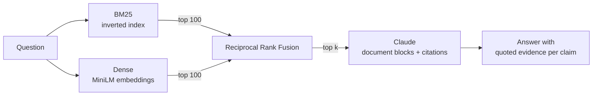

# rag-retrieval-eval

[](https://github.com/DiyarSari/rag-retrieval-eval/actions/workflows/ci.yml)


**Most RAG demos skip the step that decides answer quality: measuring retrieval.**
This project benchmarks four retrieval strategies on a standard IR dataset, picks the winner on evidence, and serves it behind an API that answers with sentence-level citations from Claude.

| | |
|---|---|
| **Dataset** | [BEIR SciFact](https://github.com/beir-cellar/beir): 5,183 scientific abstracts, 300 expert-judged test queries |
| **Retrievers** | BM25 (from scratch), dense bi-encoder, hybrid (Reciprocal Rank Fusion), cross-encoder re-ranking |
| **Metrics** | nDCG@10, MRR@10, Recall@10, Recall@100 (BEIR / `pytrec_eval` definitions) |
| **Serving** | FastAPI `/search` and `/ask`, answers grounded with the Claude Citations API |

## Results

| System | nDCG@10 | MRR@10 | Recall@10 | Recall@100 | ms / query |
|---|---:|---:|---:|---:|---:|
| BM25 | 0.664 | 0.633 | 0.783 | 0.886 | 0.1 |
| Dense (all-MiniLM-L6-v2) | 0.645 | 0.605 | 0.783 | 0.925 | 9.7 |
| **Hybrid RRF (BM25 + Dense)** | **0.694** | 0.657 | **0.825** | **0.958** | 10.0 |
| Hybrid RRF → cross-encoder rerank | 0.689 | **0.658** | 0.816 | **0.958** | 4327.4 |

<sub>CPU only (12 threads), Python 3.10, single-query latency. Reproduce with `python -m rageval.evaluate`; raw numbers in [`results/scifact.json`](results/scifact.json).</sub>

### What the numbers say

1. **The implementation is sound.** The from-scratch BM25 scores 0.664 nDCG@10 against **0.665** reported for the Elasticsearch BM25 baseline in the BEIR paper, and the MiniLM bi-encoder matches its published SciFact score (≈0.645). Reproducing known baselines first is what makes the other rows trustworthy.
2. **Hybrid search is the clear winner.** BM25 nails exact scientific terms ("25-hydroxyvitamin D"); the bi-encoder catches paraphrases. Fusing them with RRF lifts nDCG@10 by **+4.5% over BM25** and Recall@100 to **0.958**. The LLM therefore sees a relevant abstract in its context for almost every question, at ~10 ms per query.
3. **Re-ranking is not free quality.** The popular `ms-marco-MiniLM-L-6-v2` cross-encoder was trained on web search queries. On scientific claims it slightly *lowers* nDCG@10 and costs **430× the latency** on CPU. That's why the API serves plain hybrid. A domain-matched re-ranker (or a GPU) would be the next experiment, not a default.

## How it works



- **BM25** ([`retrievers.py`](src/rageval/retrievers.py)) is an inverted index over NumPy arrays with Lucene-style IDF and Anserini's defaults (k1 = 0.9, b = 0.4). Scoring touches only the postings of query terms, which keeps queries under a millisecond.
- **Dense retrieval** encodes the corpus once with `all-MiniLM-L6-v2`, caches the normalized matrix to disk, and runs an exact cosine search. At 5k documents a brute-force matrix product is faster and simpler than an ANN index.
- **Hybrid** uses Reciprocal Rank Fusion, `score(d) = Σ 1 / (60 + rank)`. It works on ranks rather than scores, so it never has to calibrate BM25 scores against cosine similarities.
- **Grounded answers** ([`answer.py`](src/rageval/answer.py)): each retrieved abstract goes to Claude as its own `document` block with citations enabled. The API returns the exact sentence each claim relies on, so you get verifiable evidence rather than a "[1]" that may or may not be true. Refusals are handled explicitly, and safety declines are retried server-side via `fallbacks`.

## Quickstart

```bash
git clone https://github.com/DiyarSari/rag-retrieval-eval && cd rag-retrieval-eval
python -m venv .venv && source .venv/bin/activate   # Windows: .venv\Scripts\activate
pip install -e ".[dev]"

# Reproduce the benchmark (downloads SciFact on first run; --no-rerank finishes in ~2 min on CPU)
python -m rageval.evaluate --dataset scifact

# Serve the API
export ANTHROPIC_API_KEY=...   # only needed for /ask
uvicorn rageval.api:app
```

Any BEIR dataset with a `test` split works, for example `--dataset nfcorpus` or `--dataset fiqa`.

## API

```bash
curl "localhost:8000/search?q=vitamin+D+and+fracture+risk&k=3&retriever=hybrid"
```
```json
[
  {"id": "30720103", "title": "Vitamin D status: measurement, interpretation, and clinical application.", "score": 0.0310},
  {"id": "4462079",  "title": "Estimation of optimal serum concentrations of 25-hydroxyvitamin D for multiple health outcomes.", "score": 0.0309},
  {"id": "23267371", "title": "Vitamin D: The \"sunshine\" vitamin.", "score": 0.0308}
]
```

```bash
curl -X POST localhost:8000/ask -H "Content-Type: application/json" \
     -d '{"question": "Does vitamin D supplementation reduce fractures?", "k": 5}'
```

The response holds `answer` (with `[doc_id]` markers), `citations` (doc id plus the quoted sentence), `sources` (the retrieved documents), and `refused`. `retriever` can be `bm25`, `dense`, or `hybrid` on both endpoints.

## Project layout

```
src/rageval/
  data.py         BEIR download + loading (corpus, queries, graded qrels)
  retrievers.py   BM25, Dense, Hybrid (RRF), Reranked behind one search() interface
  metrics.py      nDCG / MRR / Recall, matching pytrec_eval
  evaluate.py     benchmark CLI → results/<dataset>.{md,json}
  answer.py       grounded answering with Claude citations
  api.py          FastAPI service
tests/            metric values checked by hand, BM25 / RRF behaviour, answer parsing against a fake client
```

CI runs `ruff` and `pytest` on Python 3.10 and 3.12. The unit tests don't need the embedding models, so CI finishes in seconds.

## Limitations and next steps

- One dataset. SciFact is small and specialised; the hybrid > dense > BM25 ordering is known to flip on other domains. Running `nfcorpus` and `fiqa` is the obvious next step.
- Retrieval is evaluated rigorously, generation is not yet. An answer-faithfulness eval (does each cited sentence actually support its claim?) would close the loop.
- Exact search is fine at this scale; past ~1M documents the dense side would move to an ANN index (FAISS / pgvector HNSW).

## License

MIT
